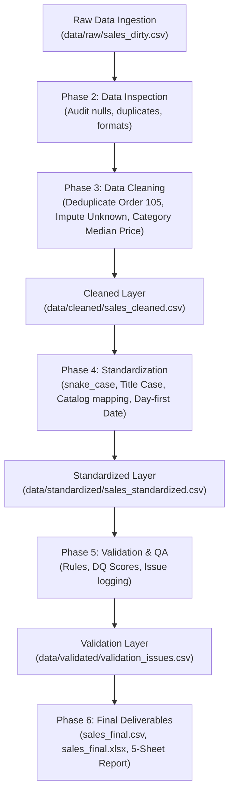

# Data Cleaning and Preprocessing System

[](https://www.python.org/)
[](https://pandas.pydata.org/)
[](https://openpyxl.readthedocs.io/)
[](#data-quality-scoring-methodology)
[](#testing-and-verification)

An enterprise-grade, reproducible **Data Cleaning, Standardization, and Quality Assurance System** built with Python, Pandas, and openpyxl. This portfolio project demonstrates a rigorous 6-phase engineering lifecycle that transforms noisy, unstructured e-commerce transaction data into audited, production-ready analytical assets.

---

## Table of Contents

1. [Project Overview](#project-overview)
2. [Business Problem Statement](#business-problem-statement)
3. [Project Objectives](#project-objectives)
4. [Real-World Use Case](#real-world-use-case)
5. [Technology Stack](#technology-stack)
6. [Project Folder Structure](#project-folder-structure)
7. [Dataset Description](#dataset-description)
8. [Step-by-Step Workflow](#step-by-step-workflow)
9. [Data Cleaning Techniques](#data-cleaning-techniques)
10. [Standardization Techniques](#standardization-techniques)
11. [Validation & Quality Assurance](#validation--quality-assurance)
12. [Data Quality Scoring Methodology](#data-quality-scoring-methodology)
13. [Installation Instructions](#installation-instructions)
14. [Execution Commands](#execution-commands)
15. [Output Deliverables](#output-deliverables)
16. [Screenshots & Visuals](#screenshots--visuals)
17. [Key Learnings](#key-learnings)
18. [Future Enhancements](#future-enhancements)
19. [Author & Contact](#author--contact)

---

## Project Overview

Data quality degradation is one of the leading causes of distorted business analytics, faulty machine learning models, and costly marketing mistakes. This project implements a modular, test-driven pipeline that systematically remediates data hygiene issues in retail sales orders without corrupting source records or silently fabricating synthetic values.

### Key Highlights
- **100% Traceable Pipeline**: Strict separation of Raw, Cleaned, Standardized, Validated, and Final data layers.
- **Auditable Business Logic**: Preserves financial transactions using category median price imputation while tagging missing metadata as `"Unknown"`.
- **Transparent Quality Scorecard**: Computes mathematical scores across Completeness (98.61%), Uniqueness (100.00%), Validity (95.45%), and Consistency (100.00%), yielding an overall score of **98.52%**.
- **Automated Issue Tracking**: Exports row-level anomalies to [validation_issues.csv](data/validated/validation_issues.csv) with severity tags (`ERROR`, `WARNING`).
- **Executive Reporting**: Generates a professional 5-sheet formatted Excel workbook ([final_data_quality_report.xlsx](reports/final_data_quality_report.xlsx)) with freeze panes, auto-filters, and conditional status formatting.

---

## Business Problem Statement

Raw transactional records ingested from disparate e-commerce and point-of-sale (POS) channels frequently suffer from:
1. **Duplicate Order Entries**: Accidental double-submissions inflate gross merchandise value (GMV) and distort accounting.
2. **Missing Customer and Location Data**: Incomplete fields drop transactions from regional sales breakdowns or crash BI dashboards.
3. **Missing Item Pricing**: Missing unit prices prevent accurate transaction margin computations.
4. **Invalid Email Syntax**: Bounced emails degrade marketing sender reputation and waste customer communication budgets.
5. **Inconsistent Naming and Casing**: Values such as `"chennai"`, `"CHENNAI"`, and `"Chennai"` fragment regional reporting into redundant buckets.
6. **Negative Quantities**: Unflagged return transactions corrupt inventory calculations if not isolated for audit.

---

## Project Objectives

- **Automate End-to-End Processing**: Provide a single executable orchestrator (`run_pipeline.py`) that runs all lifecycle phases with prerequisite validation.
- **Maintain Source Data Immutability**: Never overwrite or delete raw historical transaction records.
- **Avoid Synthetic Contamination**: Preserve missing or invalid emails rather than creating fake addresses (e.g. `unknown@example.com`).
- **Standardize Schema & Casing**: Enforce strict `snake_case` column naming, title-cased product and city names, lowercase emails, and ISO `YYYY-MM-DD` date formats.
- **Enforce Configurable Business Rules**: Validate primary keys, approved product catalogs, date windows, and numeric bounds.
- **Provide Actionable Reporting**: Deliver granular reports in text, CSV, and formatted multi-tab Excel workbooks.

---

## Real-World Use Case

In an omnichannel retail enterprise, orders flow from mobile apps, web storefronts, in-store registers, and third-party marketplaces into a central data lake. Before loading this raw transactional stream into a cloud data warehouse (e.g., BigQuery, Snowflake, Redshift) or an analytics dashboard (Power BI, Tableau), it must undergo rigorous cleaning, standardization, and quality gate validation. This project mirrors that exact data engineering workflow.

---

## Technology Stack

| Component | Technology | Version | Purpose |
| :--- | :--- | :--- | :--- |
| **Language** | Python | 3.11+ | Core runtime environment |
| **Data Processing** | Pandas | >= 2.0.0 | Tabular transformations, deduplication, imputation, and aggregation |
| **Spreadsheet Engine** | openpyxl | >= 3.1.0 | Formatted Excel workbook generation with multi-tab layout and styles |
| **Test Framework** | unittest | Built-in | Automated unit, regression, and integration testing |
| **Filesystem** | pathlib | Built-in | Robust, cross-platform filesystem path resolution |
| **Version Control** | Git | >= 2.30 | Revision control and GitHub repository management |

---

## Project Folder Structure

```
E:\Project\Data_Clearning_System\
│
├── .gitignore                                 # Git ignore patterns for Python, venv, and IDEs
├── README.md                                  # Comprehensive project documentation
├── requirements.txt                           # Minimal production dependencies
├── generate_dataset.py                        # Phase 2: Raw dirty dataset generator
├── clean_data.py                              # Phase 3: Missing values, deduplication, type casting
├── standardize_data.py                        # Phase 4: snake_case, text normalization, category mapping
├── validate_data.py                           # Phase 5: Multi-dimensional validation & QA scoring
├── export_final.py                            # Phase 6: Final deliverables & Excel workbook generator
├── run_pipeline.py                            # Master end-to-end pipeline orchestrator
│
├── data/
│   ├── raw/
│   │   └── sales_dirty.csv                    # Phase 2: Raw initial dirty dataset (immutable)
│   ├── cleaned/
│   │   └── sales_cleaned.csv                  # Phase 3: Deduplicated and imputed dataset
│   ├── standardized/
│   │   └── sales_standardized.csv             # Phase 4: Normalized snake_case dataset
│   ├── validated/
│   │   └── validation_issues.csv              # Phase 5: Granular row-level issue audit log
│   └── final/
│       ├── sales_final.csv                    # Phase 6: Production-ready clean CSV
│       └── sales_final.xlsx                   # Phase 6: Production-ready clean Excel file
│
├── reports/
│   ├── phase3_cleaning_report.txt             # Phase 3 data cleaning audit report
│   ├── phase4_standardization_report.txt      # Phase 4 standardization audit report
│   ├── phase5_validation_report.txt           # Phase 5 QA and scoring report
│   ├── final_project_report.txt               # Phase 6 consolidated project executive report
│   └── final_data_quality_report.xlsx         # Phase 6 professional 5-sheet formatted workbook
│
├── tests/
│   ├── test_cleaning.py                       # Phase 3 automated unit tests
│   ├── test_standardization.py                # Phase 4 automated unit tests
│   ├── test_validation.py                     # Phase 5 automated unit tests
│   └── test_final_deliverables.py             # Phase 6 automated regression & export tests
│
└── notebooks/                                 # Exploratory scratchpad workspace
```

---

## Dataset Description

The dataset tracks retail sales transactions across computer and mobile electronics.

| Raw Column Name | Final Column Name | Target Data Type | Description | Sample Value |
| :--- | :--- | :--- | :--- | :--- |
| `Order_ID` | `order_id` | `int64` | Unique commercial transaction identifier | `101` |
| `Customer_Name` | `customer_name` | `object (str)` | Purchasing customer name or `'Unknown'` | `Arun` |
| `Email` | `email` | `object (str)` | Customer email address or null | `arun@gmail.com` |
| `Product` | `product` | `object (str)` | Product category (`Laptop`, `Mobile`, etc.) | `Laptop` |
| `Quantity` | `quantity` | `int64` | Units ordered (positive) or returns (negative) | `1` |
| `Price` | `price` | `float64` | Unit sales price in INR | `45000.00` |
| `City` | `city` | `object (str)` | Delivery city in Tamil Nadu or `'Unknown'` | `Chennai` |
| `Order_Date` | `order_date` | `object/str` | Transaction date (`YYYY-MM-DD`) | `2026-01-01` |

---

## Step-by-Step Workflow



1. **Phase 1 – Project Setup**: Initialized directory hierarchy, virtual environment, and Git repository.
2. **Phase 2 – Dataset Creation & Inspection**: Generated baseline transaction data containing deliberate real-world flaws; logged structural dimensions.
3. **Phase 3 – Data Cleaning**: Executed primary key deduplication, imputed missing names/cities with `"Unknown"`, imputed missing price via category median, and parsed dates with day-first interpretation.
4. **Phase 4 – Data Standardization**: Normalized column headers to `snake_case`, unified city/product text casing, and audited missing value markers.
5. **Phase 5 – Data Validation & QA**: Evaluated 7 business rules, computed dimension scores (98.52% overall), and exported issue records.
6. **Phase 6 – Final Deliverables**: Exported final CSV/Excel files, generated the 5-sheet Executive Quality Workbook, and consolidated documentation.

---

## Data Cleaning Techniques

| Target Issue | Business Rule & Strategy Applied | Technical Implementation | Business Rationale |
| :--- | :--- | :--- | :--- |
| **Duplicate Order Entries** | Retain first occurrence; remove redundant records by `order_id`. | `df.drop_duplicates(subset=['order_id'], keep='first')` | Prevents \$45,000 revenue double-counting on Laptop sale (Order 105). |
| **Missing Customer Name** | Impute missing name with `'Unknown'`. | `df['Customer_Name'].fillna('Unknown')` | Preserves commercial transaction value while marking customer identity unrecorded. |
| **Missing Delivery City** | Impute missing city with `'Unknown'`. | `df['City'].fillna('Unknown')` | Retains sales revenue without distorting city-specific performance metrics. |
| **Missing Product Price** | Impute missing price with matching category median. | `df.groupby('Product')['Price'].transform('median')` | Reconstructs realistic item price (1,200.00 for Keyboard) without outlier skew. |
| **Missing Contact Email** | Preserve as missing (`NaN`); do not generate fake emails. | Preserved without synthetic string replacement | Prevents email deliverability penalties, bounce spikes, and CRM pollution. |
| **Mixed Date Formats** | Parse with day-first interpretation (`dayfirst=True`). | Custom parser checking ISO vs `DD/MM/YYYY` | Corrects `02/01/2026` to Jan 2 instead of Feb 1 (US format misinterpretation). |

---

## Standardization Techniques

- **Header Casing (`snake_case`)**: Normalized mixed-case headers (`Order_ID`, `Customer_Name`, `Order_Date`) into database-ready `snake_case` using regular expression boundary matching.
- **City Name Normalization**: Unified fragmented regional casing variations:
  - `"chennai"` and `"CHENNAI"` $\rightarrow$ `"Chennai"`
  - `"MADURAI"` $\rightarrow$ `"Madurai"`
  - Reduced distinct city variants from 8 to 5 canonical representations.
- **Product Catalog Mapping**: Standardized uppercase merchandise strings (`"MOUSE"` $\rightarrow$ `"Mouse"`) and mapped to approved categories (`Laptop`, `Mobile`, `Keyboard`, `Mouse`).
- **Whitespace & Email Normalization**: Stripped outer padding, collapsed internal whitespace sequences, and forced email strings to lowercase.
- **Consistent Export Representation**: Normalized all datetime timestamps to standard ISO `YYYY-MM-DD` strings for CSV and Excel output.

---

## Validation & Quality Assurance

### Business Rules Evaluated

| Rule | Description | Target Column | Evaluated Status | Violations Count |
| :---: | :--- | :---: | :---: | :---: |
| **Rule 1** | Primary key uniqueness | `order_id` | **PASS** | 0 |
| **Rule 2** | Positive transaction units | `quantity` | **WARNING** | 1 (Quantity = -2) |
| **Rule 3** | Non-negative unit price | `price` | **PASS** | 0 |
| **Rule 4** | Approved catalog membership | `product` | **PASS** | 0 |
| **Rule 5** | Valid date in operational window | `order_date` | **PASS** | 0 |
| **Rule 6** | Standard RFC email syntax | `email` | **ERROR** | 1 (`invalid-email`) |
| **Rule 7** | Non-empty customer name | `customer_name` | **PASS** | 0 |

### Granular Issue Audit Log ([validation_issues.csv](data/validated/validation_issues.csv))

| Row Index | Order ID | Column Name | Invalid Value | Issue Type | Severity | Description |
| :---: | :---: | :---: | :---: | :---: | :---: | :--- |
| **5** | 107 | `email` | `<MISSING>` | Missing Value | `WARNING` | Missing email for customer Suresh; requires CRM contact profile enrichment. |
| **3** | 104 | `email` | `invalid-email` | Invalid Email Format | `ERROR` | Email address does not conform to RFC syntax (missing @ or domain). |
| **5** | 107 | `quantity` | `-2` | Negative Quantity | `WARNING` | Non-positive quantity indicates potential return, exchange, or entry anomaly. |
| **6** | 108 | `city` | `Unknown` | Placeholder Location | `WARNING` | Delivery city is 'Unknown' (imputed in Phase 3); requires postal tracking verification. |
| **3** | 104 | `customer_name` | `Unknown` | Placeholder Customer Name | `WARNING` | Buyer name is 'Unknown' (imputed in Phase 3); requires payment gateway reconciliation. |

---

## Data Quality Scoring Methodology

Data quality is evaluated across **four core dimensions**, using transparent formulas that prevent double-counting:

$$\text{Overall Quality Score} = \frac{\text{Completeness} + \text{Uniqueness} + \text{Validity} + \text{Consistency}}{4}$$

| Dimension | Mathematical Formula | Evaluated Metric | Score | Assessment |
| :--- | :--- | :---: | :---: | :--- |
| **Completeness** | $\left(1 - \frac{\text{Missing Cells}}{\text{Total Cells}}\right) \times 100$ | $71 / 72 \text{ cells}$ | **98.61%** | Outstanding; single missing email preserved by policy. |
| **Uniqueness** | $\left(1 - \frac{\text{Dup Rows} + \text{Dup Order IDs}}{\text{Total Rows}}\right) \times 100$ | $0 / 9 \text{ violations}$ | **100.00%** | Perfect entity and row-level uniqueness. |
| **Validity** | $\left(1 - \frac{\text{Validity Violations}}{\text{Validity Checks}}\right) \times 100$ | $42 / 44 \text{ checks passed}$ | **95.45%** | Minor operational exceptions: 1 invalid email and 1 return quantity. |
| **Consistency** | $\left(\frac{\text{Passed Schema Dimensions}}{\text{Total Dimensions}}\right) \times 100$ | $5 / 5 \text{ dimensions}$ | **100.00%** | Perfect compliance with naming, casing, and typing rules. |
| **OVERALL SCORE** | **Arithmetic Mean of the 4 Dimensions** | $\frac{98.61 + 100.00 + 95.45 + 100.00}{4}$ | **98.52%** | **EXCELLENT (Production Ready)** |

> [!NOTE]
> **Limitations Disclosure**: Structural and syntactic validation guarantees formatting hygiene, relational integrity, and domain boundary adherence. However, a score of 98.52% does not guarantee real-world physical ground truth (e.g., valid emails may be unmonitored inboxes, and catalog entries may differ from physical warehouse fulfillment).

---

## Installation Instructions

### Prerequisites
- Python 3.11 or higher installed on your system.
- Git installed.

### Clone the Repository
```powershell
git clone https://github.com/<your-username>/Data_Clearning_System.git
cd Data_Clearning_System
```

### Create and Activate a Virtual Environment
```powershell
# Windows PowerShell
python -m venv .venv
.\.venv\Scripts\Activate.ps1
```

### Install Dependencies
```powershell
pip install -r requirements.txt
```

---

## Execution Commands

### Run the Master End-to-End Pipeline
Executes all project phases (Phase 2 to Phase 6) sequentially with automatic prerequisite checking:
```powershell
python run_pipeline.py
```

### Run Individual Lifecycle Modules
You can also run any phase independently:
```powershell
# Phase 3: Data Cleaning
python clean_data.py

# Phase 4: Data Standardization
python standardize_data.py

# Phase 5: Data Validation & QA
python validate_data.py

# Phase 6: Final Deliverables & Excel Report Generation
python export_final.py
```

### Run the Automated Test Suite
```powershell
# Run all 26 unit and integration tests across all phases
python -m unittest discover tests

# Or run specific phase tests
python -m unittest tests/test_cleaning.py
python -m unittest tests/test_standardization.py
python -m unittest tests/test_validation.py
python -m unittest tests/test_final_deliverables.py
```

---

## Output Deliverables

| Deliverable | File Path | Format | Description |
| :--- | :--- | :---: | :--- |
| **Final Cleaned CSV** | `data/final/sales_final.csv` | CSV | Final 9-row standardized dataset ready for SQL/DW ingestion |
| **Final Cleaned Excel** | `data/final/sales_final.xlsx` | Excel | Styled Excel dataset with auto-fitted columns and bold headers |
| **Quality Workbook** | `reports/final_data_quality_report.xlsx` | Excel | 5-sheet audit workbook (Executive Summary, Data Quality, Issues, etc.) |
| **Issue Audit CSV** | `data/validated/validation_issues.csv` | CSV | Machine-readable row-level log of all 5 operational exceptions |
| **Consolidated Report** | `reports/final_project_report.txt` | Text | Full 13-section technical audit and lifecycle summary |
| **Cleaning Audit** | `reports/phase3_cleaning_report.txt` | Text | Phase 3 before/after missingness and deduplication statistics |
| **Standardization Audit**| `reports/phase4_standardization_report.txt` | Text | Phase 4 column mapping, text casing, and category audit |
| **Validation Audit** | `reports/phase5_validation_report.txt` | Text | Phase 5 business rules scorecard and dimension evaluations |

---

## Screenshots & Visuals

*(Placeholders for portfolio documentation and GitHub preview)*

### 1. Executive Summary & Quality Scorecard
```
+-----------------------------------------------------------------------------------------+
| Data Cleaning & Preprocessing System - Executive Summary                                |
+-----------------------------------------------------------------------------------------+
| Project Name:        Data Cleaning and Preprocessing System                             |
| Final Records:       9 verified transactions (1 duplicate eliminated)                   |
| Overall DQ Score:    98.52% (Completeness: 98.61% | Uniqueness: 100% | Consistency: 100%)|
| Validation Status:   VALIDATED WITH KNOWN OPERATIONAL EXCEPTIONS [PASS]                 |
+-----------------------------------------------------------------------------------------+
```
*(Insert screenshot of `reports/final_data_quality_report.xlsx` - Sheet 1: Executive Summary)*

### 2. Multi-Sheet Excel Workbook Layout
*(Insert screenshot showing the 5 formatted workbook tabs: Executive Summary, Data Quality, Validation Issues, Column Summary, Cleaning Summary)*

### 3. End-to-End Terminal Pipeline Execution
*(Insert screenshot showing `python run_pipeline.py` terminal output with all green checkmarks)*

---

## Key Learnings

1. **Defensive Data Imputation**: Replacing missing values with category medians preserves financial reality without introducing outlier distortions.
2. **Preserving Truth vs Fabricating Data**: Generating fake emails (e.g. `unknown@example.com`) ruins deliverability metrics; leaving missing fields as `NaN` and flagging them for outreach is superior engineering.
3. **Ambiguity in Date Parsing**: Interpreting `02/01/2026` as day-first (`2026-01-02`) vs month-first (`2026-02-01`) completely alters financial period reporting; explicit date rules are mandatory.
4. **Separation of Pipeline Layers**: Keeping raw data strictly immutable while producing traceable intermediate layers (`cleaned`, `standardized`, `validated`, `final`) ensures 100% auditable debugging.
5. **Quality Scoring Discipline**: Syntactic scorecards must always be accompanied by clear disclosures regarding real-world semantic limitations.

---

## Future Enhancements

- **Phase 7: Advanced Outlier & Return Modeling**: Integrate automated isolation and credit-memo reconciliation for negative return quantities (`quantity = -2`).
- **Phase 8: Automated Data Ingestion Watcher**: Build a file-system watcher (e.g., using `watchdog`) that triggers `run_pipeline.py` automatically whenever new batch files land in `data/raw/`.
- **Phase 9: Great Expectations Integration**: Complement the built-in validation suite with declarative Great Expectations test suites for enterprise data mesh governance.
- **Phase 10: CI/CD GitHub Actions Workflow**: Add a GitHub Actions workflow (`.github/workflows/pipeline.yml`) to run the 26-test regression suite on every pull request.

---

## Author & Contact

**Project Lead**: Kaviyarasan (Data Analytics Engineer)  
- **Location**: Tamil Nadu, India  
- **Portfolio**: [GitHub Profile](https://github.com/)  
- **LinkedIn**: [LinkedIn Profile](https://linkedin.com/)  
- **Project Repository**: [Data_Clearning_System](https://github.com/)  

---

*This project is part of a professional Data Analytics Portfolio showcasing end-to-end data pipeline architecture, data hygiene, and automated quality assurance.*
